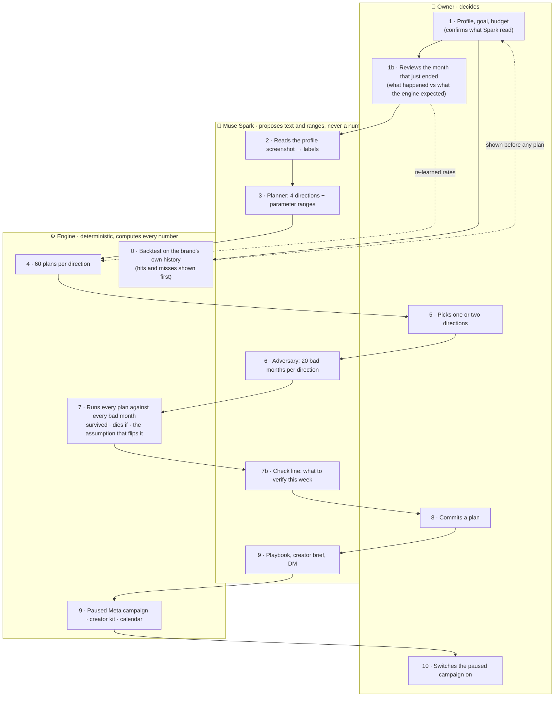
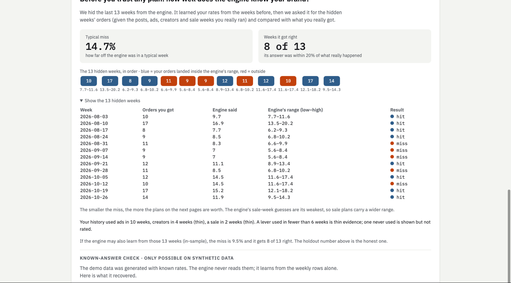
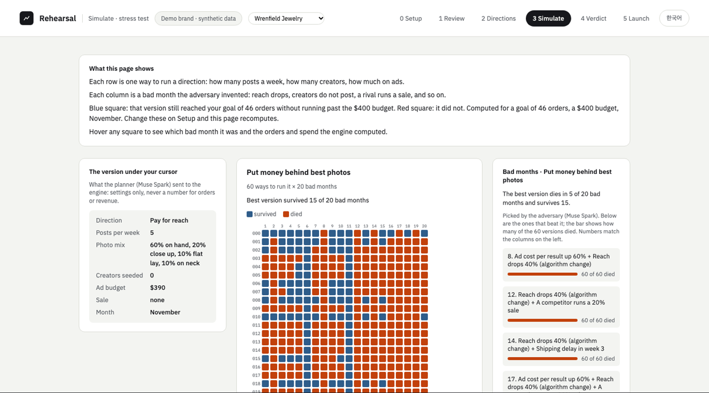
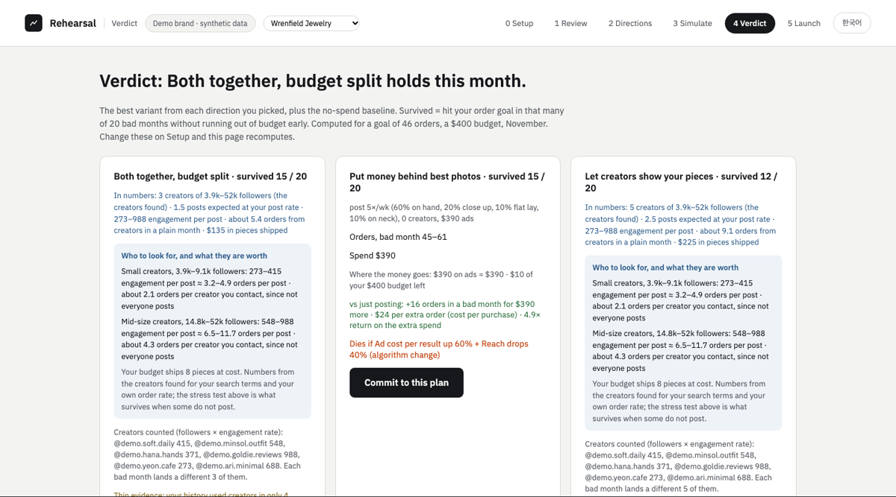
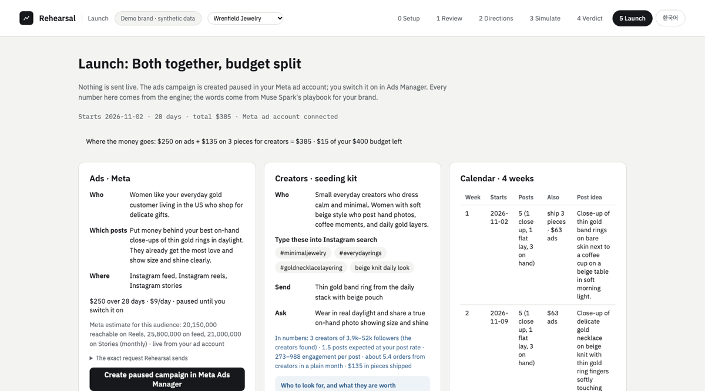
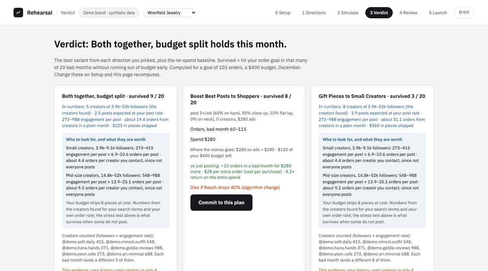

# Rehearsal

**Stress-test a small brand's monthly marketing plan before the money is spent.**
The AI proposes. A deterministic engine tests. A person decides.

Live demo: **https://rehearsal-run.fly.dev** · Built Nov 2–4, 2026 during the Meta Global AI Developer Hackathon, no external code · Go, stdlib only.

**Theme: Build for Your World.** This started with a small brand owner in my own family and the question she asks every month: ads, creators, a sale, or nothing? **Who it is for:** a small brand owner with no marketer, a few hundred dollars a month, and a plan that has never been tested against anything going wrong. They find out in week 3 that it did not work, after the budget is gone. Rehearsal moves that moment to before the spend.

It is an **agent loop**: planner (Muse Spark) → engine → adversary (Muse Spark) → engine → verdict + check line (Muse Spark) → **human commits** → executor (Muse Spark playbook + engine numbers → paused Meta campaign, creator kit, calendar). Models at both ends, a deterministic engine in the middle, a person before anything is sent.

| The model (Muse Spark) | The engine (Go, deterministic) | The owner |
|---|---|---|
| Proposes 4 directions written for this brand, with parameter ranges | Expands them into 240 plans and runs each against 20 bad months | Picks one or two directions |
| Invents the bad months: creators ghost, a rival's sale, ad costs up, the holiday lift fails | Computes every number on screen: survived, orders, cost per extra order, where the money goes | Reads the verdict and the one assumption that flips it |
| Writes the playbook, the creator brief, the DM | Builds the paused Meta campaign, the seeding kit, the calendar | Commits, then switches the campaign on |
| **Never writes an order count, a revenue figure or a rate** | **Same input, same output; checked against a Python reference** | **Nothing spends without them** |



Numbers in the boxes are the order of one month. Every arrow into the engine carries text or ranges; every arrow out of it carries numbers.

## What the screens show

**It tests itself before it tests you.** 13 weeks of the brand's history are hidden, the engine reproduces them, and every hit and miss is on screen. Levers with too little history are marked *not rated* instead of guessed. Then the month that just ended is reviewed (what happened vs what the engine expected) and the rates are re-learned before anything is planned.



**Every plan against every bad month.** Rows are plans, columns are the adversary's bad months, blue survived, red died. The panel on the right ranks the bad months by how many plans they kill.



**A verdict is a measurement.** Survived N of 20, orders in a bad month, cost per extra order versus just posting, where the money goes against the budget, and the one assumption that flips the ranking. Two picks also get a combined plan with the budget split.



**Commit, and it becomes actions.** A PAUSED campaign in the owner's real Meta ad account (the exact API request is shown first), a creator seeding kit with search terms and what each creator size is worth, and a 4-week calendar.



**A strong month raises the bar instead of flattering a plan.** Previewing next month: December demand is 2.2× an average month for jewelry, so the tool offers a month-sized goal; at that goal, just posting survives 1 of 20 bad months.



## Does it work

- **Live:** https://rehearsal-run.fly.dev, three demo brands, every screen: review the month that just ended, plan this month, launch, preview the next.
- **Numbers are checked twice:** the Go engine is compared to an independent Python reference engine through golden fixtures on every `go test ./...` (calibration, backtest, stress, flip, launch, seasonality, creator pool, budget split).
- **The model is checked on the way in:** every Spark response passes validation before it is shown (enums, sentence shape, no numbers the engine did not produce, banned words), so a bad generation degrades to a safe fallback instead of a wrong screen.
- **The engine is checked against the brand:** the hidden-weeks backtest and the known-answer recovery are on the first screen, hits and misses included.
- **The action is real:** with a Meta ad account connected, Launch created a paused campaign and ad set in a real account (verified Nov 3, 2026; nothing spends).
- **The flow is exercised end to end:** a headless-browser run clicks through all six screens for all three brands before each deploy.

## What is new here

A planning assistant that is *not allowed to do the math*. The LLM contributes what it is good at (directions written for this brand, plausible bad months, a playbook, a DM) and a deterministic engine does what it is good at (running 240 plans against 20 bad months, finding the one assumption that flips the ranking, sizing the goal to the season, splitting a budget). The engine's own error is the first thing the owner sees, and a lever with no history is shown but not rated.

## Three demo brands

Every brand is synthetic and labelled so on every screen. The header switches between them; each has its own history, mock Meta account, season table and Spark cache.

| Brand | Category | Holdout miss | Rates recovered within 10% | Best plan / baseline (Nov, after the October review, ads + creators picked) |
|---|---|---|---|---|
| Wrenfield Jewelry | jewelry | 14.7% (8 of 13 weeks inside) | 7 of 9 | 15 / 5 of 20 |
| Harbor & Pine Apparel | clothing | 14.8% (8 of 13) | 8 of 9 | 20 / 13 of 20 |
| Lumen Skincare | beauty | 18.5% (6 of 13) | 9 of 9 | 20 / 1 of 20 |

## What is real, what is not

- **Real:** the Meta ad account connection (live reach estimate; a paused campaign and ad set are created in a real account), the public data (Census monthly retail sales, Signet Jewelers quarterly sales, Gupta Media Meta CPM, Pew 2026 platform use), and the engine's own error.
- **Synthetic:** the three brands, their 52 weeks of history, their mock Instagram insights and the creators found for them. Fictional handles only.
- **Rules the code enforces:** the model's text is validated before it is shown, and any sentence quoting a number the engine did not produce is dropped; the product never claims to foresee the future; it says what survived, what dies if, and which assumption flips the answer.

## Run it

```
go run ./cmd/server                                   # http://localhost:8080, jewelry
BRAND=data/brands/beauty.json go run ./cmd/server     # another demo brand
go test ./...                                         # Go engine vs the Python reference fixtures
```

Muse Spark is called through the Meta Model API (OpenAI-compatible chat completions, text + image input); set `MUSE_BASE_URL` and `MUSE_MODEL` to use the same prompts against Baseten's `meta-models/muse-spark-open-1026`. Spark responses are cached in `spark/cache/`; the server never calls the model live. `MUSE_API_KEY=... go run ./cmd/sparkcache` regenerates a cache. `META_AD_ACCOUNT_ID` and `META_ACCESS_TOKEN` make Launch live.

## More

- [docs/DETAILS.md](docs/DETAILS.md): every mechanism, data source and design rule, in prose.
- [DEMO.md](DEMO.md): the 3-minute demo script and deploy notes.
- [SPEC.md](SPEC.md): the original spec and build order.

## Next

Connect a real shop and Instagram account (the seams exist), let a brand's own ad-account CPM replace the public ad-cost table, add more channels as levers with the same rule: a lever with no history is shown, not rated.
